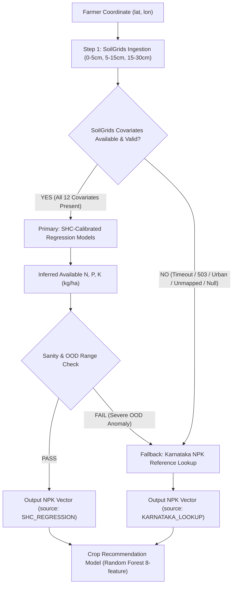

# Experimental Architecture & Fallback Design

**Module**: CropSense AI Soil Nutrient Inference Subsystem  
**Status**: Experimental Design Specification (Phase 12)  
**Isolation**: Research Only — Not Connected to Production  

---

## 1. Intended Future Architecture

If and when pedotransfer regression models achieve production-grade validation, the intended nutrient inference pipeline will follow a layered primary/fallback architecture:

---

## 2. Layer Specifications

### Layer 1: Primary — SoilGrids Pedotransfer Function (SHC-Calibrated)
- **Input**: Point latitude and longitude.
- **Data Source**: ISRIC SoilGrids 2.0 REST API or local Cloud-Optimized GeoTIFF raster stream.
- **Required Covariates**:
  - `phh2o_0-5cm`, `phh2o_0-30cm`
  - `soc_0-5cm`, `soc_0-30cm`
  - `nitrogen_0-5cm`, `nitrogen_0-30cm` (SoilGrids total nitrogen, NOT available nitrogen)
  - `clay_0-5cm`, `clay_0-30cm`
  - `sand_0-5cm`, `sand_0-30cm`
  - `cec_0-5cm`, `cec_0-30cm`
- **Model Engine**: 3 separate Random Forest regressors (`available_n_model.joblib`, `available_p_model.joblib`, `available_k_model.joblib`).
- **Output**: Point-specific continuous estimates of available N, P, and K.

### Layer 2: Deterministic Fallback — Spatial Haversine District Lookup
- **Trigger Conditions**:
  1. SoilGrids HTTP timeout (>12s), 503 Service Unavailable, or network failure.
  2. SoilGrids returns nulls (urban centers, water bodies, unmapped pixels).
  3. Predicted NPK falls into extreme non-physical values ($N < 0$, $P < 0$, $K < 0$).
- **Source**: `data/karnataka_main_places_npk_project_ready_v1.csv` via `backend/npk_lookup.py`.
- **Guarantee**: 100% deterministic, zero latency, guaranteed non-null fallback with 0 km fallback distance for state coverage.

---

## 3. Production Safety Constraints

1. **Isolation Guarantee**: The experimental provider `research/shc_calibration/experimental_npk_provider.py` must NOT be imported by `backend/predict_api.py` or any production service until explicit production sign-off.
2. **Current Production State**: `backend/predict_api.py` continues to invoke `get_nearest_npk(lat, lon)` exclusively.
